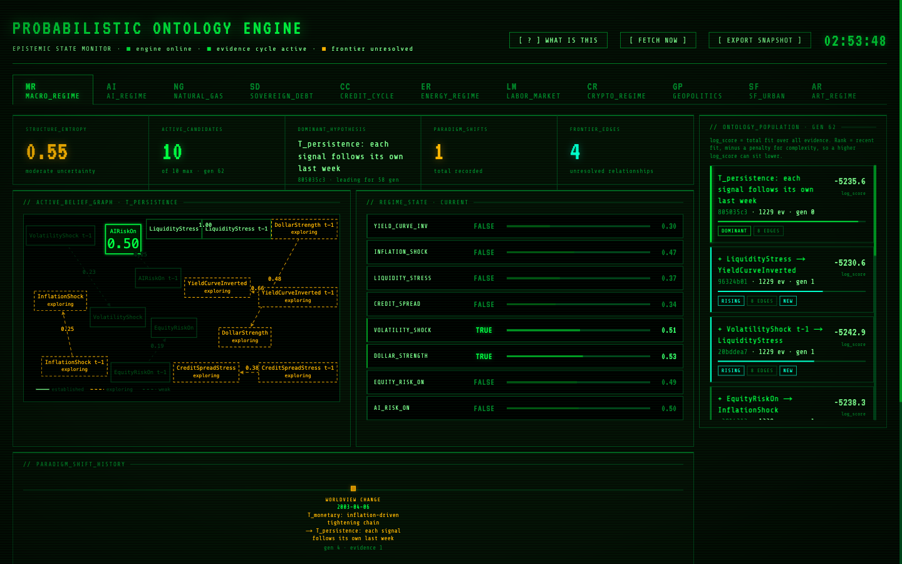

# Epistemic State Monitor

A live dashboard for the
[Probabilistic Ontology Engine](https://github.com/technoir7/probabilistic_ontology_engine),
a system that keeps several rival explanations of a domain (the macro economy,
credit, energy, crypto and seven others), scores each against public data as it
arrives week by week, and changes which one it believes when the evidence says
to. This dashboard shows that state of belief: which explanation leads, how sure
the engine is, what it is still unsure about, and when it changed its mind.

**Live:** https://epistemic-monitor-production.up.railway.app



## What the panels show

- **Status bar** — how evenly belief is spread across the rival explanations
  (structure entropy), how many are competing, which one leads and for how
  long, how often the leader has changed, and how many links are unresolved.
- **Belief graph** — the leading explanation drawn as cause-and-effect links
  between signals. Each arrow carries the probability that the link is real;
  amber dashed links are ones the engine is still testing. "X t-1" means
  last week's value of X.
- **Regime state** — the engine's current probability for each signal in the
  domain (is the yield curve inverted, is credit stressed, …).
- **Ontology population** — every competing explanation, best first. Variants
  are named by the one link they add (+) or remove (−) from their parent.
  The number shown is total fit over all evidence; the order uses recent fit
  minus a penalty for complexity.
- **Paradigm shift history** — each time the leader changed, dated by the
  evidence that caused it. Gold marks a change of worldview (a different family
  of explanation took over); a dim mark is a revision within one.
- **Exploration frontier** — links whose probability is near 0.5, which the
  engine is actively gathering evidence on.
- **Report** — a cached plain-English reading of the current state, written by
  an LLM and regenerated only on request.

Natural gas, the first domain, also shows per-edge probabilities and the raw
evidence feed.

## Stack

Next.js 14 (app router) · TypeScript · SWR (polls every 30 s) · D3 force layout
for the graph · hand-written CSS. Only the selected domain's panels are mounted,
so the page polls one domain at a time. When the engine cannot be reached, each
panel says so; nothing falls back to placeholder data.

## Run locally

Needs Node 18.17+ to run, and 22.18+ for `npm test` (it uses Node's built-in TypeScript support).

```bash
git clone https://github.com/technoir7/epistemic-monitor.git
cd epistemic-monitor
npm install
cp .env.local.example .env.local
```

Set `NEXT_PUBLIC_API_BASE_URL` in `.env.local` to an engine: the live one at
`https://epistemic-monitor-suite-production.up.railway.app`, or
`http://localhost:8000` (the default) if you run the engine yourself. Then:

```bash
npm run dev        # http://localhost:3000
```

Checks: `npx tsc --noEmit`, `npm run lint`, `npm test`, `npm run build`.

## Deployment

Hosted on Railway, which builds and deploys `main` automatically
(`railway.toml`). `NEXT_PUBLIC_API_BASE_URL` is inlined at build time, so it
must be set in the Railway service before the build runs.
